# Creatures to redo

Every creature here has a **placeholder picture made from code** (simple 3D shapes rendered in Godot),
not by an image generator. Each one needs a new painted sprite sheet in the style of the starters
(see `../style_targets/`) following the rules in `../README.md`.

- `redo_list.csv`: the same list as a spreadsheet, with each creature's prompt.
- `current_placeholders/<id>.png`: what the creature looks like now (its standing pose), so its
  body plan and colours can be kept or improved. Do **not** copy the placeholder's blocky style.

Save each new image as `art_inbox/<id>.png` and run `tools/import_creature_art.py`.

Also made from code: the **Test Bot** token (`test_bot`, a little 1/1 printed robot, Neutral), shown in
`current_placeholders/test_bot.png`. All tool and equipment card pictures were made from code too; they
are not in this list, which covers creatures only.

179 creatures.

| # | id | Name | Element | Rarity | Kind | What it does | Placeholder |
|---|---|---|---|---|---|---|---|
| 1 | `snow_globe_golem` | Snow Globe Golem | Ice | common | card | When Your Printer Is Hit: Jam a random enemy print. |  |
| 2 | `snowball_seal` | Snowball Seal | Ice | common | card | On Print: Jam an enemy print and deal 1 damage to it. |  |
| 3 | `snowdrift` | Snowdrift | Ice | common | card | Turn Start: Deal 1 damage to all enemy prints. | 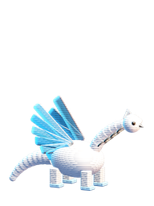 |
| 4 | `snowmite` | Snowmite | Ice | common | card | Turn End: Jam a random enemy print. |  |
| 5 | `yeti` | Yeti | Ice | rare | card | On Foe Attack: Put the attacker to sleep for 2 turns. |  |
| 6 | `arc_wasp` | Arc Wasp | Lightning | common | card | On Attack: If you have 3 or more prints, draw a card. | 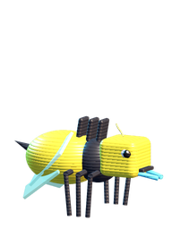 |
| 7 | `blackout_bat` | Blackout Bat | Lightning | rare | card | On Print: Put the strongest enemy print to sleep for 2 turns. | 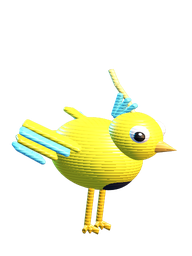 |
| 8 | `capacitor` | Capacitor | Lightning | uncommon | card | On Ally Print: Give it +1/+0. |  |
| 9 | `capacitor_crab` | Capacitor Crab | Lightning | common | card | Turn Start: If your Printer is damaged, +2 Print Speed this turn. |  |
| 10 | `gridstag` | Gridstag | Lightning | uncommon | card | On Kill: This can attack again. |  |
| 11 | `multimeterbeetle` | Multimeter Beetle | Lightning | epic | card | On Print: Deal 2 damage. |  |
| 12 | `overload_eel` | Overload Eel | Lightning | uncommon | card | On Print: Silence an enemy print: it loses its keywords and abilities. | 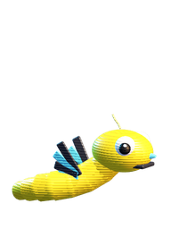 |
| 13 | `plasma_pegasus` | Plasma Pegasus | Lightning | epic | card | Turn Start: Lightning: 3 damage to a random enemy print, then 2, then 1. |  |
| 14 | `raijin_reactor` | Raijin Reactor | Lightning | legendary | card | On Print: Double the Attack of all your other prints. |  |
| 15 | `short_circuit` | Short Circuit | Lightning | uncommon | card | On Print: Your opponent gets 2 less Filament next turn. |  |
| 16 | `spark_kitten` | Spark Kitten | Lightning | common | card | Turn End: Give a random friendly print +1 Attack. |  |
| 17 | `sparkbug` | Sparkbug | Lightning | common | card | Turn Start: Deal 1 damage to a random enemy print. |  |
| 18 | `static_hedgehog` | Static Hedgehog | Lightning | common | card | On Hurt: Deal 1 damage to the enemy Printer. |  |
| 19 | `staticcub` | Staticcub | Lightning | common | card | On Kill: +1 Print Speed this turn. | 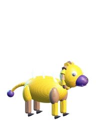 |
| 20 | `storm_dragon` | Storm Dragon | Lightning | epic | card | On Print: Lightning: 4 damage to a random enemy print, then 3, 2 and 1 to others. |  |
| 21 | `surge_owl` | Surge Owl | Lightning | uncommon | card | On Tool: Deal 1 damage to a random enemy or the enemy Printer. | 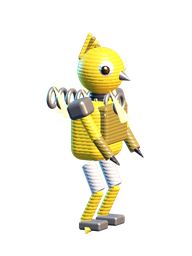 |
| 22 | `swarm_twinwing` | Swarm Twinwing | Lightning | rare | card | Swarmling. Your Swarmlings get Twin Nozzle, now and when they arrive. |  |
| 23 | `tesla_tortoise` | Tesla Tortoise | Lightning | rare | card | On Foe Attack: Deal 2 damage to the attacker. | 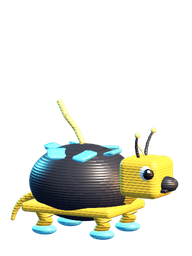 |
| 24 | `thunder_kirin` | Thunder Kirin | Lightning | epic | card | On Print: Give all your prints Rush. | 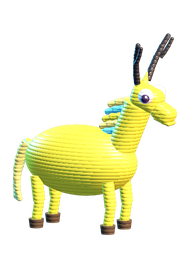 |
| 25 | `thunder_ram` | Thunder Ram | Lightning | uncommon | card | On Attack: Lightning leaps from the print it hits: 3, then 2, then 1 damage. | 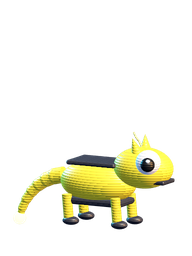 |
| 26 | `thunderbird` | Thunderbird | Lightning | epic | card | When Your Printer Is Hit: Lightning: 2 damage to a random enemy print, then 1 to another. | 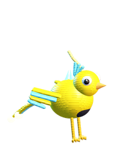 |
| 27 | `volt_ferret` | Volt Ferret | Lightning | common | card | Shatter: Give a random friendly print +1 Attack and Rush. |  |
| 28 | `voltviper` | Voltviper | Lightning | rare | card | - | 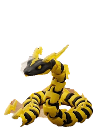 |
| 29 | `zapkit` | Zapkit | Lightning | common | card | Turn Start: +1 Print Speed this turn. |  |
| 30 | `zapling` | Zapling | Lightning | common | card | On Print: Lightning: 2 damage to a random enemy print, then 1 to another. |  |
| 31 | `barkback` | Barkback | Nature | common | card | Weakness: Deals +2 damage to Water prints. | 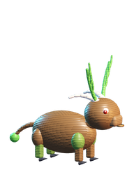 |
| 32 | `basilisk` | Basilisk | Nature | rare | card | On Print: Its gaze turns the weakest enemy print to stone: destroy it. |  |
| 33 | `bloom_druid` | Bloom Druid | Nature | uncommon | card | On Print: Repair all your prints by 2 and your Printer by 2. |  |
| 34 | `bramblemaw` | Bramblemaw | Nature | rare | card | On Foe Shatter: This gets +1/+1. |  |
| 35 | `gaia_engine` | Gaia Engine | Nature | legendary | card | On Print: Give your other prints +2/+2 and Guard. |  |
| 36 | `grove_stag` | Grove Stag | Nature | uncommon | card | On Ally Shatter: Print a 1/1 Test Bot. |  |
| 37 | `ironbark_bear` | Ironbark Bear | Nature | uncommon | card | Turn End: If this is damaged, it gets +2 Attack. |  |
| 38 | `moss_sprout` | Moss Sprout | Nature | common | card | Turn End: Give your most hurt print +0/+1. | 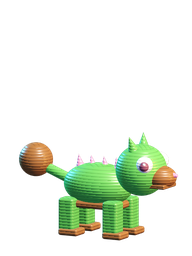 |
| 39 | `mushmunk` | Mushmunk | Nature | common | card | On Print: Repair your Printer by 2 and Cleanse your prints. | 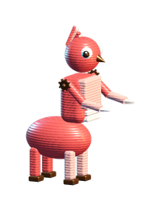 |
| 40 | `mushroom_choir` | Mushroom Choir | Nature | rare | card | On Print: Poison all enemy prints. |  |
| 41 | `nautilark` | Nautilark | Nature | rare | card | Turn Start: It gets Brim again. |  |
| 42 | `overgrowth_hydra` | Overgrowth Hydra | Nature | epic | card | Turn Start: This gets +1/+1 for each of your prints. |  |
| 43 | `pack_wolf` | Pack Wolf | Nature | common | card | On Print: This gets +1/+1 for each Nature print you have. | 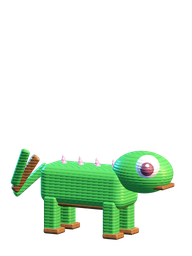 |
| 44 | `pollen_pixie` | Pollen Pixie | Nature | common | card | On Print: Cleanse a friendly print and give it +1 Attack. | 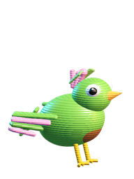 |
| 45 | `rootling` | Rootling | Nature | common | card | On Print: Add 2 Filament to your Spool for each enemy print. |  |
| 46 | `seedbomb_squirrel` | Seedbomb Squirrel | Nature | common | card | Shatter: Print two 1/1 Test Bots. | 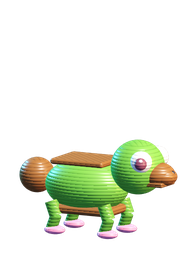 |
| 47 | `seedpup` | Seedpup | Nature | common | card | Turn Start: Add 1 Filament to your Spool. |  |
| 48 | `spaghettimess` | Spaghetti Mess | Nature | uncommon | card | On Print: Jam an enemy print and Poison it. | 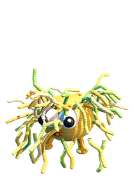 |
| 49 | `spoolcolossus` | Spool Colossus | Nature | legendary | card | On Print: Add 6 Filament to your Spool. Repair all your prints by 3. |  |
| 50 | `sproutling` | Sproutling | Nature | common | card | Turn Start: This gets +0/+1. |  |
| 51 | `sproutpaw` | Sproutpaw | Nature | common | card | Evolves into Thornfang after 2 of your turns. |  |
| 52 | `swarm_queen` | Swarm Queen | Nature | legendary | card | Swarmling. Turn Start: Print a 1/1 Swarm Larva. |  |
| 53 | `swarm_stinger` | Swarm Stinger | Nature | common | card | Swarmling. Your Swarmlings get +1 Attack, now and when they arrive. |  |
| 54 | `swarm_warden` | Swarm Warden | Nature | common | card | Swarmling. Your Swarmlings get Guard, now and when they arrive. | 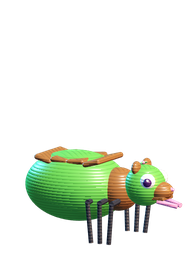 |
| 55 | `thornback_hare` | Thornback Hare | Nature | common | card | On Hurt: Deal 1 damage to all enemy prints. |  |
| 56 | `treant_elder` | Treant Elder | Nature | rare | card | Turn Start: Give your other prints +0/+1. |  |
| 57 | `supporttreant` | Tree Support Treant | Nature | epic | card | On Print: Repair all your prints by 2. |  |
| 58 | `venus_snapper` | Venus Snapper | Nature | uncommon | card | On Print: Destroy an enemy print with 2 Attack or less. |  |
| 59 | `verdant_dragon` | Verdant Dragon | Nature | epic | card | On Print: Fully repair your prints and give them Hover. |  |
| 60 | `vine_weaver` | Vine Weaver | Nature | common | card | On Print: Give a friendly print +0/+2 and Guard. |  |
| 61 | `vinehare` | Vinehare | Nature | uncommon | card | - | 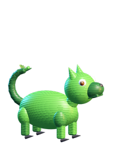 |
| 62 | `benchy_unsinkable` | Benchy the Unsinkable | Neutral | legendary | card | Shatter: Return to your hand. |  |
| 63 | `calibration_cube` | Calibration Cube | Neutral | uncommon | card | On Print: Take on the Attack and Health of another print. |  |
| 64 | `failed_print` | Failed Print | Neutral | common | card | On Print: Deal 2 damage to your own Printer. |  |
| 65 | `fp_frame` | Forbidden Frame | Neutral | legendary | card | Part of the Forbidden Printer: hold all five parts in your hand at once and you win. |  |
| 66 | `fp_hot_end` | Forbidden Hot End | Neutral | legendary | card | Part of the Forbidden Printer: hold all five parts in your hand at once and you win. |  |
| 67 | `fp_left_rail` | Forbidden Left Rail | Neutral | legendary | card | Part of the Forbidden Printer: hold all five parts in your hand at once and you win. |  |
| 68 | `fp_mainboard` | Forbidden Mainboard | Neutral | legendary | card | Part of the Forbidden Printer: hold all five parts in your hand at once and you win. |  |
| 69 | `fp_right_rail` | Forbidden Right Rail | Neutral | legendary | card | Part of the Forbidden Printer: hold all five parts in your hand at once and you win. |  |
| 70 | `glue_golem` | Glue Golem | Neutral | common | card | On Print: Give your other prints +0/+2. |  |
| 71 | `purge_line_worm` | Purge Line Worm | Neutral | uncommon | card | On Print: Cleanse all your prints and repair them by 1. | 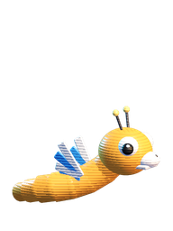 |
| 72 | `raft_crawler` | Raft Crawler | Neutral | uncommon | card | On Print: Scrap your weakest other print to get +3/+3. |  |
| 73 | `rainbow_unicorn` | Rainbow Unicorn | Neutral | epic | card | On Print: Give your prints +1/+1 for each different element among them. |  |
| 74 | `stringing_slime` | Stringing Slime | Neutral | common | card | On Foe Print: Poison the arriving print. |  |
| 75 | `support_pillar` | Support Pillar | Neutral | common | card | Shatter: Give your prints +1 Attack. |  |
| 76 | `tribute_titan` | Tribute Titan | Neutral | epic | card | On Print: Scrap your weakest other print, or this one is scrapped instead. |  |
| 77 | `basalt_colossus` | Basalt Colossus | Stone | epic | card | On Print: Your Printer gains 2 Armor for each of your prints. |  |
| 78 | `basaltbison` | Basaltbison | Stone | uncommon | card | On Attack: This gets +1/+0. | 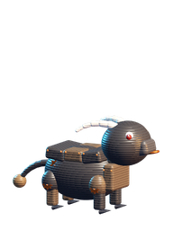 |
| 79 | `boulder_beetle` | Boulder Beetle | Stone | common | card | On Ally Shatter: This gets +1/+1. |  |
| 80 | `cairncrab` | Cairncrab | Stone | common | card | On Hurt: This gets +1/+0. |  |
| 81 | `crag_ogre` | Crag Ogre | Stone | uncommon | card | Turn End: Deal 1 damage to your own Printer. |  |
| 82 | `crystalscorp` | Crystalscorp | Stone | rare | card | - | 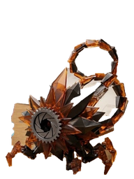 |
| 83 | `cutie` | Cutie | Stone | legendary | card | On Print: Deal 3 damage to all enemy prints. Shatter: Draw 2 cards. |  |
| 84 | `cyclops` | Cyclops | Stone | uncommon | card | On Print: Knock an enemy print with Hover out of the sky: destroy it. |  |
| 85 | `fossil_raptor` | Fossil Raptor | Stone | uncommon | card | On Print: This gets +1/+1 for each of your prints destroyed this battle. | 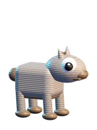 |
| 86 | `geode_armadillo` | Geode Armadillo | Stone | uncommon | card | On Hurt: Deal 1 damage to the enemy Printer for each Stone print you have. |  |
| 87 | `granitegriffin` | Granite Griffin | Stone | rare | card | On Attack: Deal 2 damage to the enemy Printer. | 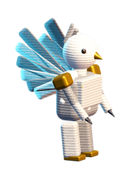 |
| 88 | `gravelhopper` | Gravelhopper | Stone | common | card | On Foe Print: Deal 1 damage to it. | 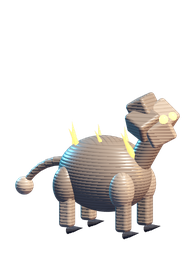 |
| 89 | `manticore` | Manticore | Stone | rare | card | On Print: Gets +1 Attack for each enemy print. |  |
| 90 | `marble_sculptor` | Marble Sculptor | Stone | uncommon | card | On Print: Give a friendly print +0/+3 and Brim. |  |
| 91 | `minotaur` | Minotaur | Stone | rare | card | On Print: Give your other Stone prints Menace. | 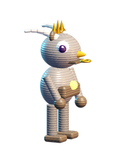 |
| 92 | `monolith` | Monolith | Stone | rare | card | On Ally Shatter: This gets +2/+0. | 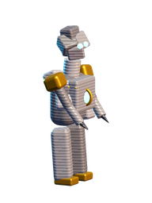 |
| 93 | `mountain_king` | Mountain King | Stone | legendary | card | On Print: Your Printer gains Armor equal to the damage it has taken. |  |
| 94 | `obsidian_dragon` | Obsidian Dragon | Stone | legendary | card | When Your Printer Is Hit: Deal 3 damage to the enemy Printer. | 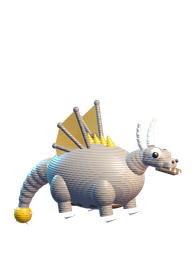 |
| 95 | `obsidianray` | Obsidian Ray | Stone | uncommon | card | - | 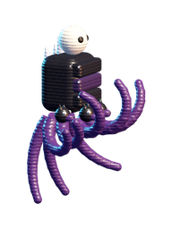 |
| 96 | `obsidian_sentinel` | Obsidian Sentinel | Stone | rare | card | When Your Printer Is Hit: Deal 2 damage to a random enemy print. |  |
| 97 | `pebbit` | Pebbit | Stone | common | card | Evolves into Bouldron after 2 of your turns. |  |
| 98 | `pebble_golemite` | Pebble Golemite | Stone | common | card | On Print: Your Printer gains 2 Armor for each Stone print you have. | 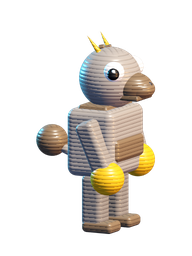 |
| 99 | `pebblepup` | Pebblepup | Stone | common | card | On Hurt: Your Printer gains 1 Armor. |  |
| 100 | `quarry_crusher` | Quarry Crusher | Stone | rare | card | On Attack: Destroy the print it hits if that print was already damaged. | 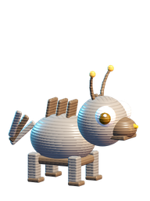 |
| 101 | `rubble_hound` | Rubble Hound | Stone | common | card | On Kill: Your Printer gains 2 Armor. | 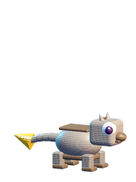 |
| 102 | `sandpiper` | Sandpiper | Stone | common | card | On Attack: Your Printer gains 1 Armor. | 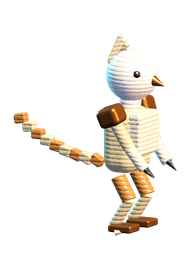 |
| 103 | `sandstone_scarab` | Sandstone Scarab | Stone | common | card | Shatter: Your Printer gains 3 Armor. | 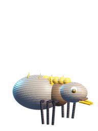 |
| 104 | `statue_gargoyle` | Statue Gargoyle | Stone | uncommon | card | Turn Start: If it is your only print, it gets +1/+1 and Guard. |  |
| 105 | `steppergolem` | Stepper Golem | Stone | uncommon | card | Shatter: Your Printer gains 2 Armor. |  |
| 106 | `swarm_carapace` | Swarm Carapace | Stone | uncommon | card | Swarmling. Your Swarmlings get +0/+2, now and when they arrive. |  |
| 107 | `abyssal_angler` | Abyssal Angler | Water | rare | card | On Print: Take a print from your deck into your hand. |  |
| 108 | `benchyboss` | Benchy Boss | Water | rare | card | On Print: Repair your Printer by 3 and print a 1/1 Test Bot. | 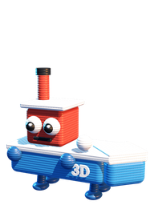 |
| 109 | `brine_bard` | Brine Bard | Water | uncommon | card | On Ally Print: Repair your Printer by 1. |  |
| 110 | `brineleech` | Brineleech | Water | rare | card | On Attack: Poison the print it hit. |  |
| 111 | `bubbleray` | Bubbleray | Water | common | card | On Ally Shatter: Repair your Printer by 1. |  |
| 112 | `coral_sentinel` | Coral Sentinel | Water | rare | card | When Your Printer Is Hit: This gets +1 Attack. |  |
| 113 | `dewdrop_sprite` | Dewdrop Sprite | Water | common | card | Turn Start: Repair your Printer by 1 for each Water print you have. |  |
| 114 | `dripling` | Dripling | Water | common | card | Evolves into Splashard after 2 of your turns. |  |
| 115 | `kelp_strangler` | Kelp Strangler | Water | common | card | On Attack: Jam the print it hits. | 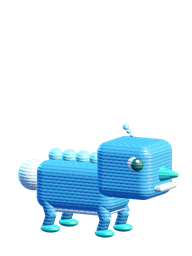 |
| 116 | `kelpie` | Kelpie | Water | uncommon | card | On Attack: Drag the print it hits back to its owner's hand if it has 2 Attack or less. |  |
| 117 | `kraken` | Kraken | Water | legendary | card | On Print: Pull the strongest enemy print onto your side for good. |  |
| 118 | `leviathan` | Leviathan | Water | legendary | card | On Print: Swap the Attack and Health of every enemy print. |  |
| 119 | `mistwalker` | Mistwalker | Water | common | card | On Ally Print: This gets +1/+0. | 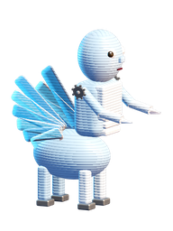 |
| 120 | `mistweaver` | Mistweaver | Water | common | card | On Print: If you have 3 or fewer cards in hand, draw 2 cards. |  |
| 121 | `narwhal_lancer` | Narwhal Lancer | Water | rare | card | On Kill: This gets +2/+2. |  |
| 122 | `pearl_oyster` | Pearl Oyster | Water | common | card | Turn End: Your Printer gains 1 Armor. |  |
| 123 | `puddle_mimic` | Puddle Mimic | Water | rare | card | On Print: Print a copy of an enemy print on your side. |  |
| 124 | `reefhopper` | Reefhopper | Water | common | card | On Kill: Draw a card. |  |
| 125 | `resinjelly` | Resin Jellyfish | Water | epic | card | On Print: Repair your Printer by 4. Draw a card. |  |
| 126 | `siphon_squid` | Siphon Squid | Water | uncommon | card | On Attack: Drain 2 Health from the enemy Printer into yours. |  |
| 127 | `siphonshark` | Siphonshark | Water | uncommon | card | Weakness: Deals +2 damage to Fire prints. |  |
| 128 | `spool_hydra` | Spool Hydra | Water | epic | card | On Hurt: Grow a 1/1 Hydra Head beside it. |  |
| 129 | `swarm_leech` | Swarm Leech | Water | rare | card | Swarmling. Your Swarmlings get Siphon, now and when they arrive. |  |
| 130 | `tidal_dragon` | Tidal Dragon | Water | epic | card | Turn End: Repair your Printer by 3 and Cleanse your prints. | 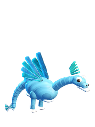 |
| 131 | `tidecaller_crab` | Tidecaller Crab | Water | common | card | Turn Start: Repair your most hurt print by 2. | 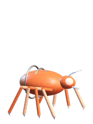 |
| 132 | `tsunami_titan` | Tsunami Titan | Water | legendary | card | On Print: Send every other print back to its owner's hand. |  |
| 133 | `whirlpool_ray` | Whirlpool Ray | Water | rare | card | On Print: Swap a print's Attack and Health. |  |
| 134 | `aero_mantis` | Aero Mantis | Wind | uncommon | card | On Kill: This gets Hover. |  |
| 135 | `breeze_finch` | Breeze Finch | Wind | common | card | On Print: Give a friendly print Hover. |  |
| 136 | `breezepup` | Breezepup | Wind | common | card | On Print: Cleanse your prints of Heat, Jam and Poison. | 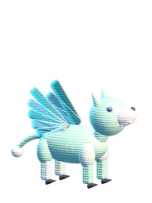 |
| 137 | `cloudhopper` | Cloudhopper | Wind | common | card | On Foe Print: This gets +1/+0. |  |
| 138 | `cyclone_serpent` | Cyclone Serpent | Wind | rare | card | On Attack: Blow the print it hits back to its owner's hand. | 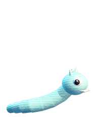 |
| 139 | `feather_duster_fox` | Feather Duster Fox | Wind | common | card | Shatter: Draw a card. |  |
| 140 | `gantrymantis` | Gantry Mantis | Wind | uncommon | card | - |  |
| 141 | `griffin_knight` | Griffin Knight | Wind | rare | card | On Print: Give a friendly print Hover and +2 Attack. |  |
| 142 | `gust_glider` | Gust Glider | Wind | common | card | On Kill: Fly back to your hand. |  |
| 143 | `gustkit` | Gustkit | Wind | common | card | On Attack: Deal 1 damage to the enemy Printer. |  |
| 144 | `jetstream_dragonfly` | Jetstream Dragonfly | Wind | rare | card | On Ally Attack: Deal 1 damage to the enemy Printer. |  |
| 145 | `kite_drake` | Kite Drake | Wind | uncommon | card | On Print: Give all your Wind prints Hover. |  |
| 146 | `pegasus_courier` | Pegasus Courier | Wind | uncommon | card | Turn End: Give a random friendly print Hover. |  |
| 147 | `pinfeather` | Pinfeather | Wind | common | card | On Attack: Draw a card. |  |
| 148 | `rotordrone` | Rotor Drone | Wind | rare | card | On Print: +1 Print Speed this turn. |  |
| 149 | `sky_pirate_parrot` | Sky Pirate Parrot | Wind | uncommon | card | On Attack: Steal 2 Filament from your opponent's Spool. |  |
| 150 | `skyhawk` | Skyhawk | Wind | uncommon | card | - |  |
| 151 | `storm_roc` | Storm Roc | Wind | epic | card | On Print: Blow the strongest enemy print back to its owner's hand. |  |
| 152 | `stormdrake` | Stormdrake | Wind | rare | card | - |  |
| 153 | `swarm_glider` | Swarm Glider | Wind | uncommon | card | Swarmling. Your Swarmlings get Hover, now and when they arrive. |  |
| 154 | `swarm_scout` | Swarm Scout | Wind | common | card | Swarmling. Your Swarmlings get Rush, now and when they arrive. | 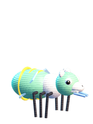 |
| 155 | `swiftwhip` | Swiftwhip | Wind | uncommon | card | - |  |
| 156 | `sylph_queen` | Sylph Queen | Wind | legendary | card | On Print: Your opponent throws away 2 random cards and gets 2 less Filament next turn. |  |
| 157 | `tempest_dragon` | Tempest Dragon | Wind | epic | card | On Kill: Blow the strongest enemy print back to its owner's hand. |  |
| 158 | `tempestlynx` | Tempest Lynx | Wind | rare | card | - |  |
| 159 | `tornado_weasel` | Tornado Weasel | Wind | uncommon | card | On Print: Your opponent throws away a random card from their hand. | 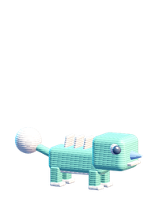 |
| 160 | `whirligig` | Whirligig | Wind | common | card | On Print: If your opponent has more prints than you, print two 1/1 Test Bots. |  |
| 161 | `windmill_golem` | Windmill Golem | Wind | uncommon | card | Turn Start: +1 Print Speed this turn for each Wind print you have. |  |
| 162 | `wyvern_rider` | Wyvern Rider | Wind | uncommon | card | On Attack: Give a random friendly print +1/+1. | 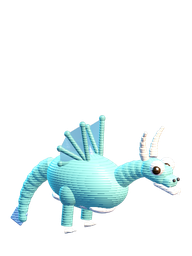 |
| 163 | `zephyr_sprite` | Zephyr Sprite | Wind | common | card | On Ally Print: Give the arriving print Hover. |  |
| 164 | `alicorn` | Alicorn | Arcane | legendary | token | Turn Start: Repair your Printer by 3 and give your prints +1/+1. | 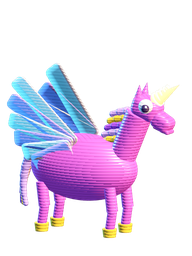 |
| 165 | `teravox` | Teravox | Arcane | legendary | token | On Attack: Draw a card. |  |
| 166 | `unicorn` | Unicorn | Arcane | rare | token | Turn Start: Cleanse your prints and repair them by 1. Evolves into Alicorn after 3 of your turns. |  |
| 167 | `voxelion` | Voxelion | Arcane | rare | token | Evolves into Teravox after 3 of your turns. | 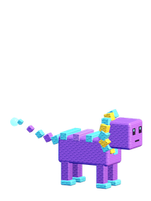 |
| 168 | `dragon_hatchling` | Dragon Hatchling | Fire | rare | token | Evolves into Elder Wyrm after 3 of your turns. |  |
| 169 | `elder_wyrm` | Elder Wyrm | Fire | legendary | token | On Attack: Deal 2 damage to all enemy prints. |  |
| 170 | `extrudrake` | Extrudrake | Fire | rare | token | Evolves into Infernozzle after 3 of your turns. |  |
| 171 | `infernozzle` | Infernozzle | Fire | legendary | token | Turn Start: Deal 2 damage to the enemy Printer. |  |
| 172 | `elderbloom` | Elderbloom | Nature | legendary | token | Turn End: Give your other prints +1/+1. |  |
| 173 | `swarm_larva` | Swarm Larva | Nature | common | token | Swarmling. | 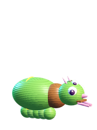 |
| 174 | `thornfang` | Thornfang | Nature | rare | token | Evolves into Elderbloom after 3 of your turns. | 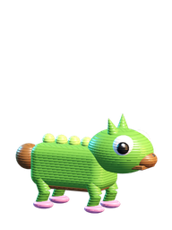 |
| 175 | `bouldron` | Bouldron | Stone | rare | token | Evolves into Titanite after 3 of your turns. | 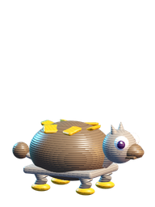 |
| 176 | `titanite` | Titanite | Stone | legendary | token | When Your Printer Is Hit: Your Printer gains 2 Armor. |  |
| 177 | `hydra_head` | Hydra Head | Water | common | token | - |  |
| 178 | `splashard` | Splashard | Water | rare | token | Evolves into Torrentus after 3 of your turns. |  |
| 179 | `torrentus` | Torrentus | Water | legendary | token | Turn Start: Repair all your prints by 2. |  |
