# Creatures to redo

Every creature here has a **placeholder picture made from code** (simple 3D shapes rendered in Godot),
not by an image generator. Each one needs a new painted sprite sheet in the style of the starters
(see `../style_targets/`) following the rules in `../README.md`.

- `redo_list.csv`: the same list as a spreadsheet, with each creature's prompt.
- `current_placeholders/<id>.png`: what the creature looks like now (its standing pose), so its
  body plan and colours can be kept or improved. Do **not** copy the placeholder's blocky style.

Save each new image as `art_inbox/<id>.png` and run `tools/import_creature_art.py`.

Also made from code: the **Test Bot** token (`test_bot`, a little 1/1 printed robot, Neutral), shown in
`current_placeholders/test_bot.png`. All tool and equipment card pictures were made from code too; they
are not in this list, which covers creatures only.

72 creatures.

| # | id | Name | Element | Rarity | Kind | What it does | Placeholder |
|---|---|---|---|---|---|---|---|
| 1 | `spark_kitten` | Spark Kitten | Lightning | common | card | Turn End: Give a random friendly print +1 Attack. |  |
| 2 | `zapling` | Zapling | Lightning | common | card | On Print: Lightning: 2 damage to a random enemy print, then 1 to another. | 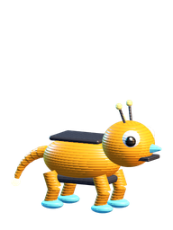 |
| 3 | `rootling` | Rootling | Nature | common | card | On Print: Add 2 Filament to your Spool for each enemy print. | 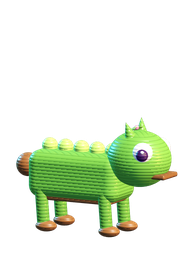 |
| 4 | `seedbomb_squirrel` | Seedbomb Squirrel | Nature | common | card | Shatter: Print two 1/1 Test Bots. |  |
| 5 | `swarm_stinger` | Swarm Stinger | Nature | common | card | Swarmling. Your Swarmlings get +1 Attack, now and when they arrive. |  |
| 6 | `venus_snapper` | Venus Snapper | Nature | uncommon | card | On Print: Destroy an enemy print with 2 Attack or less. |  |
| 7 | `glue_golem` | Glue Golem | Neutral | common | card | On Print: Give your other prints +0/+2. |  |
| 8 | `geode_armadillo` | Geode Armadillo | Stone | uncommon | card | On Hurt: Deal 1 damage to the enemy Printer for each Stone print you have. | 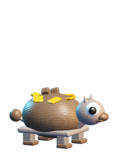 |
| 9 | `kelpie` | Kelpie | Water | uncommon | card | On Attack: Drag the print it hits back to its owner's hand if it has 2 Attack or less. |  |
| 10 | `kraken` | Kraken | Water | legendary | card | On Print: Pull the strongest enemy print onto your side for good. |  |
| 11 | `leviathan` | Leviathan | Water | legendary | card | On Print: Swap the Attack and Health of every enemy print. |  |
| 12 | `mistwalker` | Mistwalker | Water | common | card | On Ally Print: This gets +1/+0. |  |
| 13 | `mistweaver` | Mistweaver | Water | common | card | On Print: If you have 3 or fewer cards in hand, draw 2 cards. | 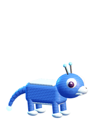 |
| 14 | `narwhal_lancer` | Narwhal Lancer | Water | rare | card | On Kill: This gets +2/+2. |  |
| 15 | `pearl_oyster` | Pearl Oyster | Water | common | card | Turn End: Your Printer gains 1 Armor. |  |
| 16 | `puddle_mimic` | Puddle Mimic | Water | rare | card | On Print: Print a copy of an enemy print on your side. |  |
| 17 | `reefhopper` | Reefhopper | Water | common | card | On Kill: Draw a card. |  |
| 18 | `resinjelly` | Resin Jellyfish | Water | epic | card | On Print: Repair your Printer by 4. Draw a card. |  |
| 19 | `siphon_squid` | Siphon Squid | Water | uncommon | card | On Attack: Drain 2 Health from the enemy Printer into yours. |  |
| 20 | `siphonshark` | Siphonshark | Water | uncommon | card | Weakness: Deals +2 damage to Fire prints. |  |
| 21 | `spool_hydra` | Spool Hydra | Water | epic | card | On Hurt: Grow a 1/1 Hydra Head beside it. |  |
| 22 | `swarm_leech` | Swarm Leech | Water | rare | card | Swarmling. Your Swarmlings get Siphon, now and when they arrive. |  |
| 23 | `tidal_dragon` | Tidal Dragon | Water | epic | card | Turn End: Repair your Printer by 3 and Cleanse your prints. |  |
| 24 | `tidecaller_crab` | Tidecaller Crab | Water | common | card | Turn Start: Repair your most hurt print by 2. |  |
| 25 | `tsunami_titan` | Tsunami Titan | Water | legendary | card | On Print: Send every other print back to its owner's hand. |  |
| 26 | `whirlpool_ray` | Whirlpool Ray | Water | rare | card | On Print: Swap a print's Attack and Health. |  |
| 27 | `aero_mantis` | Aero Mantis | Wind | uncommon | card | On Kill: This gets Hover. | 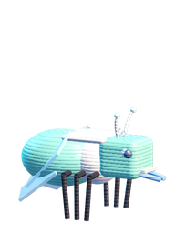 |
| 28 | `breeze_finch` | Breeze Finch | Wind | common | card | On Print: Give a friendly print Hover. | 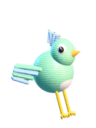 |
| 29 | `breezepup` | Breezepup | Wind | common | card | On Print: Cleanse your prints of Heat, Jam and Poison. |  |
| 30 | `cloudhopper` | Cloudhopper | Wind | common | card | On Foe Print: This gets +1/+0. |  |
| 31 | `cyclone_serpent` | Cyclone Serpent | Wind | rare | card | On Attack: Blow the print it hits back to its owner's hand. |  |
| 32 | `feather_duster_fox` | Feather Duster Fox | Wind | common | card | Shatter: Draw a card. | 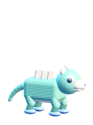 |
| 33 | `gantrymantis` | Gantry Mantis | Wind | uncommon | card | - | 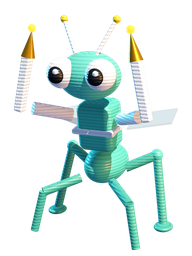 |
| 34 | `griffin_knight` | Griffin Knight | Wind | rare | card | On Print: Give a friendly print Hover and +2 Attack. |  |
| 35 | `gust_glider` | Gust Glider | Wind | common | card | On Kill: Fly back to your hand. |  |
| 36 | `gustkit` | Gustkit | Wind | common | card | On Attack: Deal 1 damage to the enemy Printer. |  |
| 37 | `jetstream_dragonfly` | Jetstream Dragonfly | Wind | rare | card | On Ally Attack: Deal 1 damage to the enemy Printer. | 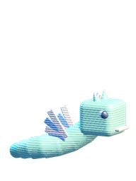 |
| 38 | `kite_drake` | Kite Drake | Wind | uncommon | card | On Print: Give all your Wind prints Hover. | 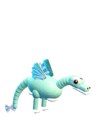 |
| 39 | `pegasus_courier` | Pegasus Courier | Wind | uncommon | card | Turn End: Give a random friendly print Hover. |  |
| 40 | `pinfeather` | Pinfeather | Wind | common | card | On Attack: Draw a card. |  |
| 41 | `rotordrone` | Rotor Drone | Wind | rare | card | On Print: +1 Print Speed this turn. |  |
| 42 | `sky_pirate_parrot` | Sky Pirate Parrot | Wind | uncommon | card | On Attack: Steal 2 Filament from your opponent's Spool. |  |
| 43 | `skyhawk` | Skyhawk | Wind | uncommon | card | - |  |
| 44 | `storm_roc` | Storm Roc | Wind | epic | card | On Print: Blow the strongest enemy print back to its owner's hand. |  |
| 45 | `stormdrake` | Stormdrake | Wind | rare | card | - | 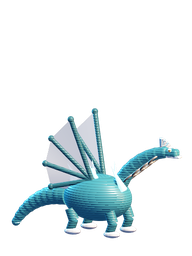 |
| 46 | `swarm_glider` | Swarm Glider | Wind | uncommon | card | Swarmling. Your Swarmlings get Hover, now and when they arrive. | 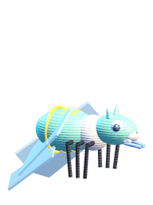 |
| 47 | `swarm_scout` | Swarm Scout | Wind | common | card | Swarmling. Your Swarmlings get Rush, now and when they arrive. |  |
| 48 | `swiftwhip` | Swiftwhip | Wind | uncommon | card | - |  |
| 49 | `sylph_queen` | Sylph Queen | Wind | legendary | card | On Print: Your opponent throws away 2 random cards and gets 2 less Filament next turn. |  |
| 50 | `tempest_dragon` | Tempest Dragon | Wind | epic | card | On Kill: Blow the strongest enemy print back to its owner's hand. | 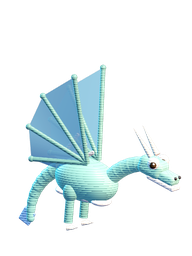 |
| 51 | `tempestlynx` | Tempest Lynx | Wind | rare | card | - | 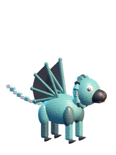 |
| 52 | `tornado_weasel` | Tornado Weasel | Wind | uncommon | card | On Print: Your opponent throws away a random card from their hand. |  |
| 53 | `whirligig` | Whirligig | Wind | common | card | On Print: If your opponent has more prints than you, print two 1/1 Test Bots. | 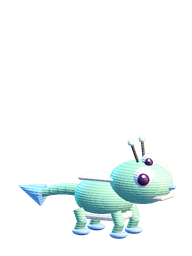 |
| 54 | `windmill_golem` | Windmill Golem | Wind | uncommon | card | Turn Start: +1 Print Speed this turn for each Wind print you have. | 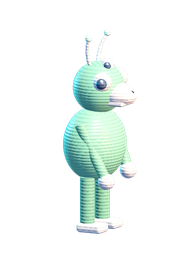 |
| 55 | `wyvern_rider` | Wyvern Rider | Wind | uncommon | card | On Attack: Give a random friendly print +1/+1. |  |
| 56 | `zephyr_sprite` | Zephyr Sprite | Wind | common | card | On Ally Print: Give the arriving print Hover. |  |
| 57 | `alicorn` | Alicorn | Arcane | legendary | token | Turn Start: Repair your Printer by 3 and give your prints +1/+1. |  |
| 58 | `teravox` | Teravox | Arcane | legendary | token | On Attack: Draw a card. |  |
| 59 | `unicorn` | Unicorn | Arcane | rare | token | Turn Start: Cleanse your prints and repair them by 1. Evolves into Alicorn after 3 of your turns. |  |
| 60 | `voxelion` | Voxelion | Arcane | rare | token | Evolves into Teravox after 3 of your turns. |  |
| 61 | `dragon_hatchling` | Dragon Hatchling | Fire | rare | token | Evolves into Elder Wyrm after 3 of your turns. | 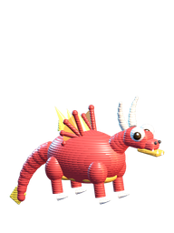 |
| 62 | `elder_wyrm` | Elder Wyrm | Fire | legendary | token | On Attack: Deal 2 damage to all enemy prints. |  |
| 63 | `extrudrake` | Extrudrake | Fire | rare | token | Evolves into Infernozzle after 3 of your turns. |  |
| 64 | `infernozzle` | Infernozzle | Fire | legendary | token | Turn Start: Deal 2 damage to the enemy Printer. |  |
| 65 | `elderbloom` | Elderbloom | Nature | legendary | token | Turn End: Give your other prints +1/+1. |  |
| 66 | `swarm_larva` | Swarm Larva | Nature | common | token | Swarmling. |  |
| 67 | `thornfang` | Thornfang | Nature | rare | token | Evolves into Elderbloom after 3 of your turns. |  |
| 68 | `bouldron` | Bouldron | Stone | rare | token | Evolves into Titanite after 3 of your turns. |  |
| 69 | `titanite` | Titanite | Stone | legendary | token | When Your Printer Is Hit: Your Printer gains 2 Armor. |  |
| 70 | `hydra_head` | Hydra Head | Water | common | token | - |  |
| 71 | `splashard` | Splashard | Water | rare | token | Evolves into Torrentus after 3 of your turns. |  |
| 72 | `torrentus` | Torrentus | Water | legendary | token | Turn Start: Repair all your prints by 2. |  |
